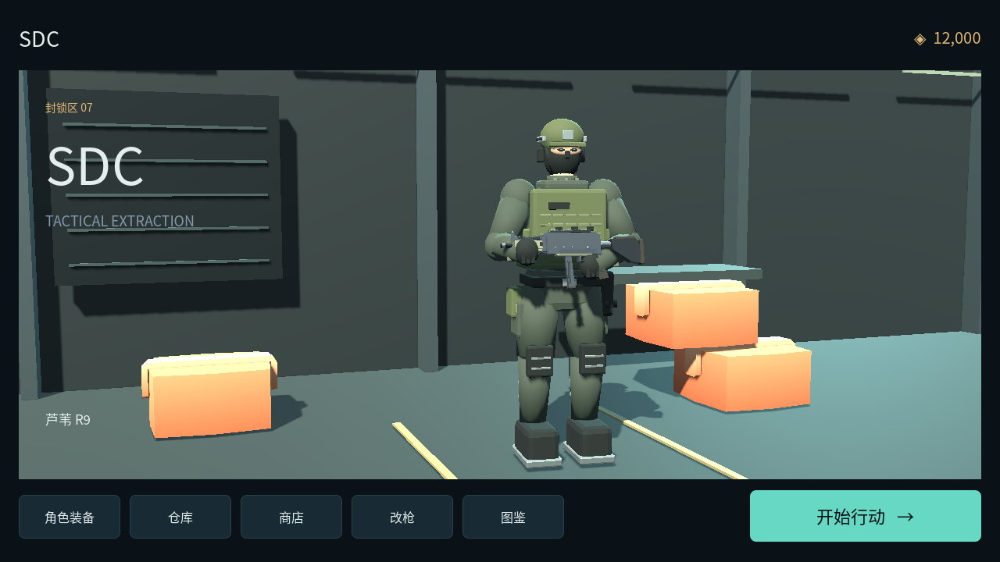

# SDC 0.4.14

Godot 4.6.3 / GDScript 开发的 Android ARM64 单机 PvE 2.5D 搜打撤原型。
当前完整工程、运行素材和来源说明已纳入 Git，入口为 [`SDC/project.godot`](SDC/project.godot)。

最新游戏代码在 [`fix-game-bugs` 分支](https://github.com/sonrunqing/SDC/tree/fix-game-bugs)，
代码审查在 [PR #1](https://github.com/sonrunqing/SDC/pull/1)。

## AI 与源码入口

读取本分支即可获得完整游戏；审查先读两级 `AGENTS.md`，再按需读 `DECISIONS.md`、
`LESSONS.md` 和 `HANDOFF.md`。源码审查不需要 Android 私钥、Blender 或本机工具目录。
游戏运行输入面向手机原始触摸，不包含键鼠操作回退。

```sh
git clone --branch fix-game-bugs https://github.com/sonrunqing/SDC.git
```

## 打开工程

克隆仓库并切换到要检查的分支，用 Godot 4.6.3 打开 `SDC/project.godot`，按 F5 运行。
项目使用 GL Compatibility 渲染器。无需 Blender 或 Android 签名文件即可查看源码和打开桌面工程；
现成 GLB 已包含在工程中，Blender 主要用于编辑、加工和重新生成模型。

## 当前内容

- 独立的移动摇杆、瞄准摇杆和左上开火按钮。
- 装备与 500 格仓库合并，支持拖动、点击放置、双击快捷转移及自动横竖摆放。
- 工业港模块化模型拼装、进入式建筑、碰撞与物资点。
- 自定义操作按键：拖动位置、单独大小与透明度、辅助键显隐、重置与 3 套保存方案。
- 实时枪械拼装、三武器栏、七项枪械性能，以及画面、声音和操控设置。
- 0.4.4 修正预览页无法出击、重复点击重建地图、背包误卸下等问题；地图支持单指平移、双指缩放与旋转。
- 0.4.6 修正大厅按钮按下后不恢复且不执行动作：触摸与模拟鼠标不再抢占同一次操作。
- 0.4.7 全面改为原始手机触摸，移除键鼠操作与输入模拟；当前仓库单选可查看全部 296 件物品的详情。
- 普通弹挂只储物，可配防弹衣；新增独立分组的防弹弹挂，替代防弹衣并在装备页淡色占位。
- Ashfront 主体镜头、光照、角色动作、敌人、视野和特效已移接；尚未完全实现旧项目画面一致。
- 26 个室内物资容器、逐件搜索动画、双击/点选后放置/拖动转移；48种原创模型变卖物、8类掉落池。
- 右下瞄准摇杆驱动世界十字准星，菜单改为小圆形齿轮；圆形搜索键仅靠近可直接接触物资时显示，按压绑定目标并在离开时取消。
- 品质实色背景、原色图标与交互提示独立绘制，未知物品不提前显示品质。

详情见 [`SDC/README.md`](SDC/README.md)、[0.4.4 修改记录](SDC/docs/MOBILE_FIXES_0_4_4.md)、
[0.4.6 按钮修复](SDC/docs/TOUCH_INPUT_FIX_0_4_6.md)和[代码审查入口](docs/CODE_REVIEW.md)。

## Android 安装与更新

当前交付版本为 **0.4.14 / versionCode 21**，包名保持 `org.prototype.shooter25d`。
已安装固定签名的 0.4.3 时，可直接覆盖更新；后续沿用同一密钥并增加版本。

旧 GitHub Release 的云端 0.3.0 使用另一签名，是历史产物；它不能被本机新签名直接覆盖。
用户已同意在 0.4.3 迁移时进行一次卸载重装。不要把这种一次迁移变成今后每次更新的流程。
详见[签名与更新记录](SDC/docs/ANDROID_UPDATES.md)。

APK 在本机导出，本 PR 不新增 GitHub Release。APK 和签名私钥不存放于 Git 源码目录。

本轮记录见 [准星与物品分层](SDC/docs/MOBILE_RETICLE_0_4_13.md)、
[圆形上下文按键](SDC/docs/ROUND_CONTEXT_BUTTONS_0_4_14.md) 和
[公开构建身份](development/android-v0.4.14.json)。
[实际引擎预览图](development/previews/README.md) 用于展示制作结果，非手机截图；
本轮没有新增或运行自动测试，没有真机触摸、性能或覆盖安装结果。

## 项目内容

- `SDC/scripts/`、`SDC/scenes/`、`SDC/data/`：游戏代码、场景及数据。
- `SDC/assets/`：模型、贴图、图标、字体、音效和来源许可。
- `SDC/docs/`、`SDC/tests/`：系统说明、既有检查与辅助脚本。
- `previews/`：历史大厅、地图、商店、改枪和战局预览。
- `development/`：历史工具记录及当前 APK 的公开构建身份。



当前玩法见 [`SDC/README.md`](SDC/README.md)，素材来源见
[`SDC/THIRD_PARTY_ASSETS.md`](SDC/THIRD_PARTY_ASSETS.md)。预览图可能早于当前界面。

## 项目现状

这是离线单人开发原型，尚未实现多人服务器、账号和联网经济系统。
各版本的导出和 APK 身份记录见 `development/android-v*.json`；开发侧尚未完成这版的真机操作验证。
既有检查脚本已随源码保留，本次为建立代码审查入口没有新增或执行测试，也没有自动合并 PR。
